  

  
  
  

  

  

  

  

  
  

<table>
  <tr>
    <td width="210" align="center">
      
    </td>
    <td>
      <h3>🌹 Climb the rose tower</h3>
      

        An <b>Icy Tower-style climber</b> I built with <b>Phaser + TypeScript</b>. 
        Wall jumps, combos, roses and power-ups — plus <b>online races with up to 4 friends</b>. 
        Plays right in your browser: desktop, phone or gamepad.
      

      

        
      

      ⌨️ <code>←</code> <code>→</code> run · <code>Space</code> jump · <code>S</code> power · <code>P</code> pause
    </td>
  </tr>
</table>

  
    
  

  Drawn in my own README design system · numbers redrawn every night by a GitHub Action

