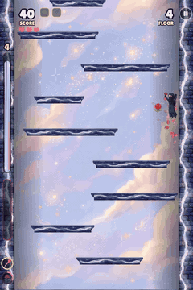

<!-- ============ HEADER ============ -->

  

  

  
  
  

---

## 🧑‍💻 About me

  

  
<b>🔭 What I care about when I build (click to expand)</b>

   

- ⚡ **Performance** — small bundles, fast loads, smooth animations
- 🎨 **Pixel-perfect UI** — turning Figma designs into real, responsive interfaces
- ♿ **Accessibility** — semantic HTML and ARIA done right
- 🧩 **Clean components** — reusable, readable, easy to maintain

  
<b>📫 How to reach me (click to expand)</b>

   

- 💼 LinkedIn: [abdelrahman-magdy-elawady](https://www.linkedin.com/in/abdelrahman-magdy-elawady/)
- 🧠 HackerRank: [abdalrahman_mag1](https://www.hackerrank.com/abdalrahman_mag1)

---

## 🎮 Play my game — Tower Jump

<table>
  <tr>
    <td width="210" align="center">
      
    </td>
    <td>
      <h3>🌹 Climb the rose tower</h3>
      

        An <b>Icy Tower-style climber</b> I built with <b>Phaser + TypeScript</b>. 
        Wall jumps, combos, roses and power-ups — plus <b>online races with up to 4 friends</b>. 
        Plays right in your browser: desktop, phone or gamepad.
      

      

        
      

      ⌨️ <code>←</code> <code>→</code> run · <code>Space</code> jump · <code>S</code> power · <code>P</code> pause
    </td>
  </tr>
</table>

---

## 🛠️ Tech Stack

  
    
  

  

---

## 📊 GitHub stats

  
  

  

  

<!-- ============ FOOTER ============ -->

  

